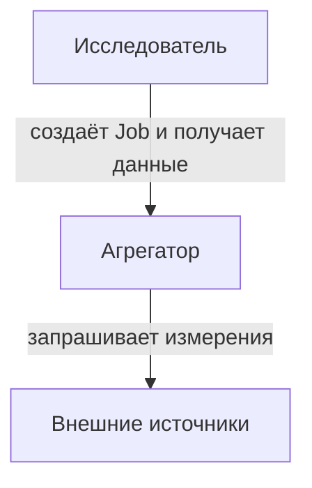
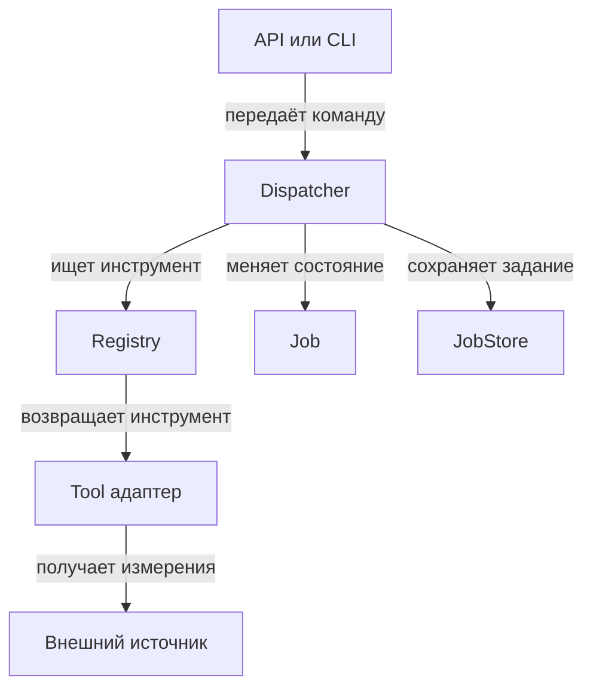
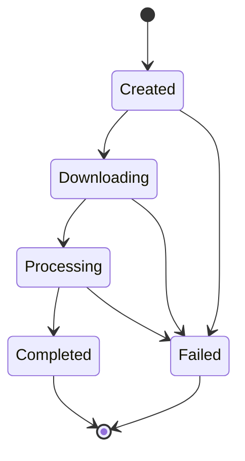

# Архитектура агрегатора геофизических данных

## Контекст (C4 Context)

Стрелки показывают внешние запросы/ответы и пользовательские операции, а не зависимости кода.

## Компоненты

Стрелки показывают вызовы во время выполнения. Зависимости кода направлены внутрь: Dispatcher зависит от интерфейсов Job/Tool/Registry/JobStore, но не от конкретного HTTP-фреймворка, БД или поставщика данных.

| Компонент | Ответственность | Что скрывает |
|---|---|---|
| API/CLI | Преобразует внешний запрос в команду и ответ | HTTP/CLI формат и транспорт |
| Dispatcher | Выбирает адаптер, выполняет Job, связывает результат или ошибку с состоянием | Конкретные источники и транспорт источника |
| Registry | Находит Tool по имени | Способ создания/регистрации адаптеров |
| Job | Проверяет разрешённость переходов и хранит итог/ошибку | Правила конечного автомата |
| Tool | Получает данные одного источника и возвращает нормализованный результат | Формат и особенности конкретного источника |
| JobStore | Сохраняет и загружает Job | Конкретное хранилище; для практики 3 — память |
| External source | Предоставляет исходные измерения | — |

## Состояния Job

`Completed` и `Failed` — конечные состояния. Любой неуказанный переход запрещён и должен вернуть `invalid_job_transition`, не меняя Job. Отмена и повторное использование того же Job не поддерживаются; повторный сбор — новый Job.
