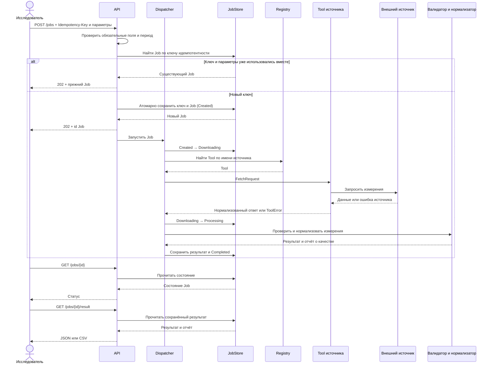
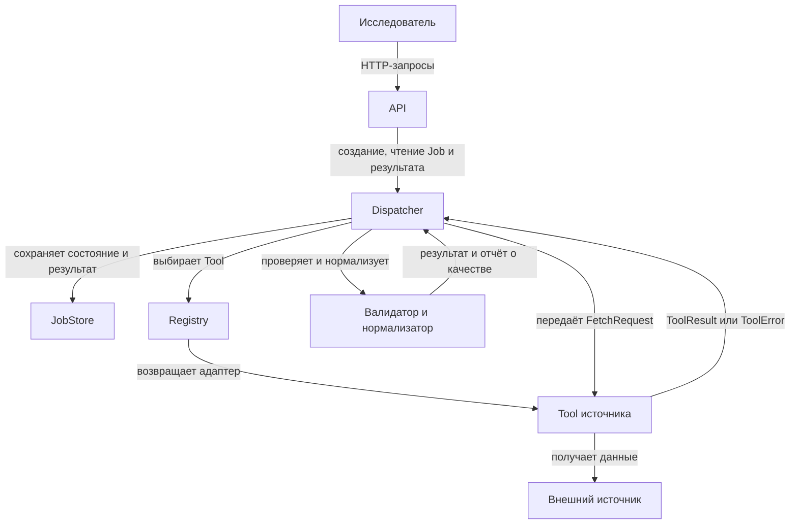
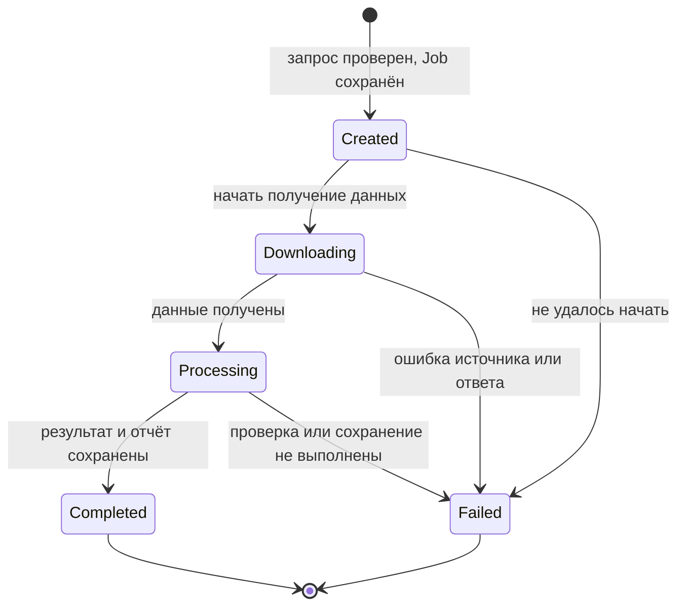

# Архитектура агрегатора геофизических данных

Документ описывает целевое устройство первой версии и её основной сценарий. Диаграммы показывают предполагаемое взаимодействие компонентов; они не означают, что API или интеграции с реальными источниками уже реализованы.

## Контекст системы

Исследователь задаёт источник, станцию, компоненты измерений и период, затем получает статус задания и сохранённый результат. Для каждого Job выбирается один источник. Агрегатор обращается к внешнему источнику от своего имени; внешний источник не вызывает агрегатор.

Стрелки показывают внешние запросы и ответы. Внутренняя структура агрегатора раскрыта на диаграмме компонентов.

## Основной сценарий: сбор измерений

Последовательность показывает успешный путь. Если запрос не проходит начальную проверку, API возвращает ошибку до создания Job и обращения к источнику. Если ошибка возникает после создания Job, Dispatcher переводит его в `Failed` и сохраняет безопасную причину. Повтор одинакового запроса с тем же ключом и параметрами возвращает прежний Job; тот же ключ с другими параметрами даёт конфликт и не создаёт новое задание. Запрос результата не запускает сбор повторно.

Сохранение результата и переход `Processing → Completed` выполняются одной неделимой операцией: пользователь не должен увидеть `Completed` без результата. Пока Job не завершён успешно, запрос результата возвращает ошибку «Результат ещё не готов».

## Компоненты и взаимодействие

Стрелки показывают вызовы во время выполнения, а не импорты или зависимости кода. Ответы показаны там, где они важны для понимания контракта. `JobStore` в текущем описании первой версии — абстракция хранения; конкретное хранилище не должно менять правила переходов Job.

| Компонент | Ответственность | Что скрывает |
|---|---|---|
| API | Проверяет форму входного запроса, принимает команды и выдаёт статус или результат | HTTP-маршруты, сериализацию и коды ответов |
| Dispatcher | Организует выполнение Job и связывает его этапы с состояниями | Порядок вызовов и обработку результата или ошибки |
| Registry | Находит Tool по имени источника | Создание и регистрацию адаптеров |
| Job | Хранит состояние и проверяет допустимость переходов | Правила конечного автомата |
| Tool | Запрашивает один внешний источник и преобразует его ответ в общий контракт | Формат, авторизацию и особенности конкретного источника |
| Валидатор и нормализатор | Проверяет обязательные поля измерений, единицы и временные метки; формирует отчёт о качестве | Общие правила проверки и приведения данных |
| JobStore | Сохраняет и загружает Job, ключ идемпотентности, результат и отчёт | Конкретный механизм хранения и транзакции |
| Внешний источник | Предоставляет исходные измерения | Доступность и формат ответа контролируются адаптером |

Добавление нового источника требует реализации Tool и регистрации его в Registry; Dispatcher продолжает работать с общим контрактом. Подробные поля `FetchRequest`, `ToolResult` и `ToolError` заданы в [контракте Tool](tool-contract.md), а HTTP-запросы — в [OpenAPI](api/openapi.yaml).

## Состояния Job

`Completed` и `Failed` — конечные состояния. Конечное состояние не означает удаление Job: запись и её причина сохраняются для чтения. Повторный сбор создаёт новый Job с новым ключом; отмена и повторное использование того же Job в первой версии не поддерживаются.

### Запрещённые переходы

Разрешены только переходы, показанные на диаграмме и перечисленные в требованиях. Любая попытка изменить Job иначе отклоняется с `invalid_job_transition`; состояние, результат и ошибка остаются без изменений.

| Попытка | Почему запрещена | Реакция |
|---|---|---|
| `Created → Processing` или `Created → Completed` | Нельзя пропустить получение и проверку данных | Ошибка перехода; Job остаётся `Created` |
| `Downloading → Completed` | Нельзя завершить сбор без этапа проверки и нормализации | Ошибка перехода; Job остаётся `Downloading` |
| Возврат назад, например `Processing → Downloading` | Этап уже пройден; возврат мог бы повторно запросить источник или изменить результат | Ошибка перехода; данные Job не меняются |
| `Completed → любое другое состояние` | Успешный результат уже зафиксирован и не должен переписываться | Ошибка перехода; результат сохраняется |
| `Failed → любое другое состояние` | Ошибка и завершение задания уже зафиксированы; повтор — отдельный Job | Ошибка перехода; причина ошибки сохраняется |
| Повторная команда с тем же состоянием, например `Downloading → Downloading` | Повторное присвоение не является переходом или способом повторно запустить работу | Ошибка перехода; Job не меняется |

Валидатор переходов находится в доменной модели `Job`, а не в Tool или API: ни адаптер, ни внешний запрос не могут напрямую назначить состояние. API преобразует `invalid_job_transition` в ответ конфликта по контракту. Обычное чтение статуса не является переходом и доступно в любом состоянии.

## Границы и связанные документы

- Бизнес-сценарии, критерии приёмки и полный список разрешённых переходов: требования первой версии.
- HTTP-операции и форматы запросов/ошибок: [OpenAPI](api/openapi.yaml).
- Параметры получения данных, нормализованный результат и ошибки адаптера: [контракт Tool](tool-contract.md).

Диаграммы описывают целевую архитектуру. Функции, помеченные в требованиях как будущие, нельзя считать реализованными только потому, что они показаны на схемах.
