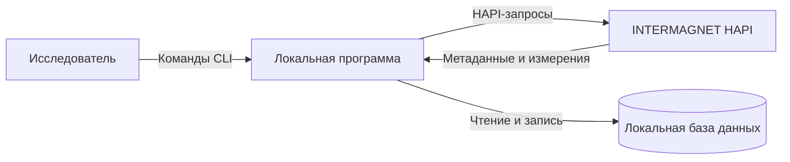
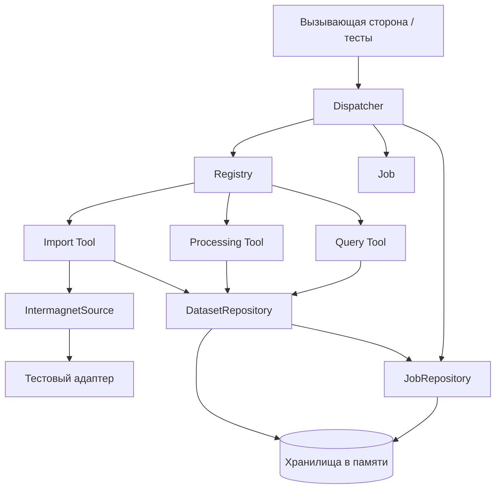
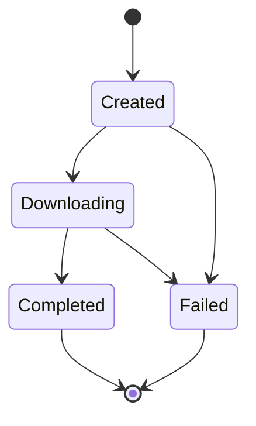
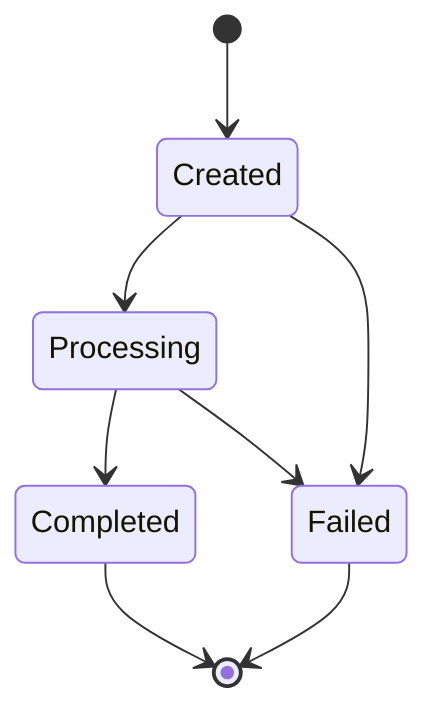

# Архитектура локальной программы геомагнитных данных

## Назначение

Программа работает на компьютере исследователя.
Она получает геомагнитные данные через HAPI-интерфейс
INTERMAGNET, сохраняет исходный ответ, выполняет
обработку по отдельному запросу и предоставляет
доступ к сохранённым наборам.

В программе предусмотрены три Tool:

- INTERMAGNET Import Tool.
- Processing Tool.
- Local Data Query Tool.

Tool — внутренняя операция программы с общим
программным контрактом.

Локальный HTTP-сервер не предусмотрен.
Целевой пользовательский интерфейс — CLI.

## Целевая архитектура

Внешний доступ необходим только для импорта.
Обработка и чтение выполняются над локальными данными.

Внешний HAPI endpoint:

https://imag-data.bgs.ac.uk/GIN_V1/hapi

Контракт внешнего сервиса описан в `tool-contract.md`.

## Реализация практики 3

На практике 3 реализовано доменное ядро на Python
без веб-фреймворка и базы данных.

Вместо постоянной БД используются хранилища в памяти.
Внешний INTERMAGNET подменяется тестовым адаптером
при выполнении автоматических тестов.

Пользовательский CLI и настоящий HTTP-адаптер
пока не реализованы.

## Компоненты

| Компонент | Ответственность | Файл |
|---|---|---|
| Job | Состояния и допустимые переходы | `core/job.py` |
| DomainError | Единый формат доменных ошибок | `core/errors.py` |
| Tool, ToolResult | Общий контракт инструментов | `core/contracts.py` |
| Registry | Поиск Tool по имени операции | `core/registry.py` |
| Dispatcher | Валидация через Tool, создание и выполнение Job | `core/dispatcher.py` |
| JobRepository | Хранение Job и идемпотентность | `core/repository.py` |
| DatasetRepository | Хранение и видимость наборов | `core/datasets.py` |
| IntermagnetSource | Интерфейс внешнего источника | `core/intermagnet.py` |
| Import Tool | Получение и сохранение сырого набора | `tools/import_tool.py` |
| Processing Tool | Обработка и сохранение отдельного результата | `tools/processing_tool.py` |
| Query Tool | Чтение наборов, фильтрация и пагинация | `tools/query_tool.py` |

Dispatcher не импортирует конкретные Tool.
Новый Tool добавляется регистрацией в Registry
без изменения Dispatcher.

## Общий контракт выполнения

Каждый Tool реализует методы:

- `validate(parameters)` — проверка параметров.
- `execute(parameters, job_id=None)` — выполнение
  операции с возвратом ToolResult.

Атрибут `job_kind` определяет, требуется ли Job.

- Import Tool — IMPORT.
- Processing Tool — PROCESS.
- Query Tool — None.

Tool не меняет состояние Job напрямую.
Состояние изменяется Dispatcher через методы Job.

Доменные ошибки представлены классом DomainError
с полями `code`, `message` и необязательными `details`.

## Job и переходы

Импорт и обработка имеют отдельные жизненные циклы.

### Импорт

### Обработка

Completed и Failed являются конечными состояниями.

Недопустимые переходы отклоняются самим Job
с ошибкой invalid_job_transition.

Изменение состояния защищено блокировкой.
Повторный запуск существующего Job невозможен.

Чтение данных не создаёт Job.

## Dispatcher

Dispatcher выполняет следующие действия:

1. Получает Tool из Registry.
2. Проверяет общую структуру параметров.
3. Для операций с Job проверяет ключ идемпотентности
   и наличие ранее созданного задания.
4. Если найден прежний Job с теми же параметрами,
   возвращает его без повторного запуска.
5. Проверяет параметры новой операции через Tool.
6. Для операции с Job атомарно получает или создаёт Job.
7. Запускает Tool и обрабатывает результат.
8. При успешном выполнении завершает Job.
9. При ошибке выполнения переводит Job в Failed.

Для синхронных операций без Job возвращается ToolResult.

Dispatcher может выполнять задания синхронно
или через переданный executor.

Синхронный режим используется для простых тестов.
Фоновый режим поддерживает выполнение внутри
одного процесса приложения.

## Идемпотентность

Ключи идемпотентности общие для импорта и обработки.

Повтор с тем же ключом, операцией и параметрами
возвращает существующий Job.

Повтор с тем же ключом и изменённой операцией
или параметрами отклоняется с idempotency_conflict.

Проверка и создание Job выполняются атомарно
под блокировкой хранилища.

Новый ключ означает новый запрос.
Дедупликация содержимого наборов не предусмотрена.

## Основные сценарии

### 1. Импорт

Import Tool проверяет параметры, получает ответ
через IntermagnetSource и сохраняет сырой набор.

В практике 3 используются контролируемые HAPI-ответы
в JSON. Сохраняются исходное тело, разобранные записи
и метаданные происхождения.

HAPI status 1200 означает успешное получение данных.
HAPI status 1201 означает успешное получение
пустого набора.

### 2. Обработка

Processing Tool читает готовый сырой набор,
выполняет зарегистрированный метод обработки
и сохраняет новый обработанный набор.

В практике 3 реализован демонстрационный
метод count_records.

Исходный набор остаётся неизменным.

### 3. Чтение

Query Tool возвращает конкретный набор
или страницу кратких описаний.

Поддерживаются фильтры по типу набора, обсерватории,
исходному набору и временному интервалу.

Сортировка:

- created_at по убыванию;
- dataset_id по возрастанию при одинаковом created_at.

Размер страницы по умолчанию — 100, максимум — 1000.

Для стабильной пагинации используется снимок результатов
в памяти. Новые наборы не изменяют уже начатый обход.

## Хранение и происхождение

Сырой и обработанный наборы имеют разные идентификаторы.

Для сырого набора сохраняются:

- идентификатор набора INTERMAGNET;
- параметры источника;
- временной интервал;
- метаданные;
- исходное тело ответа;
- разобранные записи;
- время получения;
- идентификатор Job.

Для обработанного набора сохраняются:

- ссылка на исходный сырой набор;
- идентификатор метода;
- параметры обработки;
- происхождение исходных данных;
- результат обработки;
- время выполнения;
- идентификатор Job.

Хранилище защищает сохранённое содержимое от случайного
изменения посредством копирования при записи и чтении.

Набор доступен для чтения только после завершения
связанного Job в состоянии Completed и при совпадении
идентификатора результата Job с идентификатором набора.

Это обеспечивает согласованную видимость данных,
но не заменяет транзакции постоянной БД.

## Восстановление заданий

При запуске приложения незавершённые Job в состояниях
Created, Downloading и Processing должны переводиться
в Failed с ошибкой job_interrupted.

В практике 3 реализован метод
`Dispatcher.recover_interrupted_jobs()`.

Он вызывается до запуска новых заданий.
Автоматический повтор прерванной работы не выполняется.

Реальное сохранение истории между перезапусками
потребует постоянного хранилища.

## Ограничения текущей реализации

- Хранилища и ключи идемпотентности существуют
  только в памяти текущего процесса.
- Реальный HTTP-адаптер INTERMAGNET отсутствует.
- Полная проверка внешних метаданных ещё не реализована.
- Пользовательский CLI отсутствует.
- Научные методы обработки не определены.
- Курсоры пагинации существуют в памяти без срока жизни.
- Постоянные транзакции будут реализованы позднее.

Данные ограничения не отменяют целевую архитектуру,
зафиксированную в практике 2.
