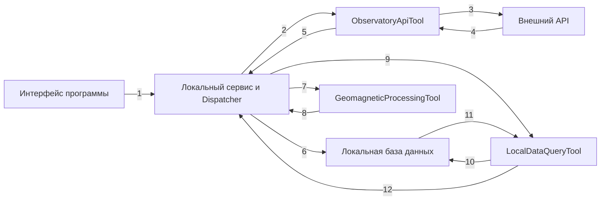
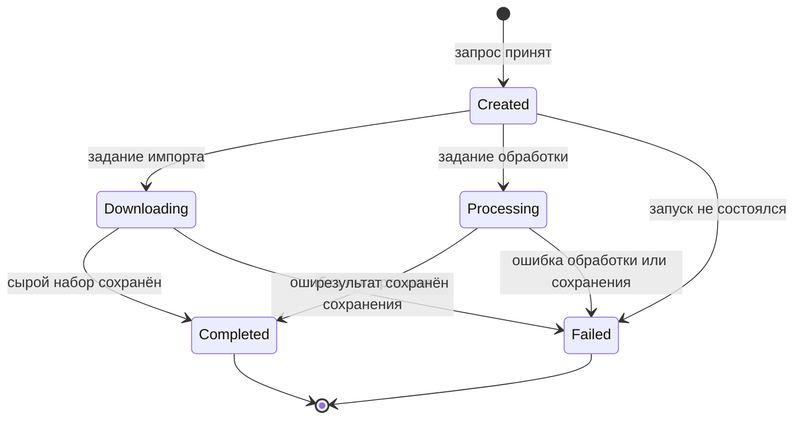

# Архитектура локального агрегатора геомагнитных данных

## Назначение и границы

Программа устанавливается и работает на компьютере исследователя. Она получает сырые данные о геомагнитном поле из разных обсерваторий через один внешний API, сохраняет их в локальной базе, по запросу обрабатывает выбранный набор и сохраняет результат отдельно от исходных данных. Пользователь может читать оба вида данных из локальной базы.

В первой версии предусмотрены три Tool: загрузка через внешний API, обработка сохранённых сырых данных и чтение локальной базы. Точный внешний API, движок локальной базы и методы обработки ещё предстоит выбрать. В документе они не подменяются выдуманными интеграциями или алгоритмами.

## Контекст системы

Номера на стрелках раскрыты ниже. Стрелки 2 и 4 показывают ответы на вызовы, а не самостоятельные обращения исследователя или API. Внешний API — единственная внешняя зависимость для получения сырых данных. Локальная база находится на компьютере исследователя и входит во внутреннее устройство программы.

| № | Направление | Взаимодействие |
|---|---|---|
| 1 | Исследователь → программа | Запросить загрузку, обработку или чтение данных |
| 2 | Программа → исследователь | Показать состояние задания, данные или сообщение об ошибке |
| 3 | Программа → внешний API | Запросить сырые измерения для выбранных обсерваторий, компонент и периода |
| 4 | Внешний API → программа | Вернуть записи измерений или ошибку |

## Компоненты

| № | Вызов или данные | Ответственность |
|---|---|---|
| 1 | Интерфейс → локальный сервис | Передаёт запрос исследователя |
| 2 | Сервис → `ObservatoryApiTool` | Запускает импорт сырых измерений |
| 3–4 | Tool ↔ единый внешний API | Запрашивает данные разных обсерваторий и получает записи или ошибку |
| 5 | `ObservatoryApiTool` → сервис | Возвращает сырые записи и метаданные загрузки |
| 6 | Сервис ↔ локальная база | Сохраняет сырой набор, загружает его для обработки и сохраняет обработанный набор |
| 7–8 | Сервис ↔ `GeomagneticProcessingTool` | Передаёт сырые записи и параметры обработки, получает отдельный результат |
| 9, 12 | Сервис ↔ `LocalDataQueryTool` | Запрашивает и получает сохранённые наборы или их части |
| 10–11 | `LocalDataQueryTool` ↔ локальная база | Читает метаданные и записи; не меняет их и не обращается к внешнему API |

Локальный сервис управляет заданиями и транзакциями хранения. Tool не подменяет базу и не выбирает произвольные адреса: внешний адрес и настройки API принадлежат адаптеру. Обработанный набор хранится отдельно и содержит ссылку на исходный сырой набор; исходные записи не перезаписываются обработкой.

## Основные сценарии

### 1. Загрузка сырых данных

1. Исследователь выбирает одну или несколько обсерваторий, компоненты геомагнитного поля и временной период.
2. Локальная программа проверяет запрос и создаёт задание на импорт.
3. `ObservatoryApiTool` обращается к одному внешнему API с выбранными параметрами и получает сырые записи.
4. Программа сохраняет полученный набор и сведения о запросе в локальную базу.
5. Задание завершается; интерфейс показывает его состояние и идентификатор сохранённого набора. Сырые значения сохраняются для дальнейшей обработки.

### 2. Обработка сохранённых данных

1. Исследователь выбирает сырой набор из локальной базы и задаёт метод обработки с его параметрами.
2. Программа загружает исходные записи и передаёт их `GeomagneticProcessingTool`.
3. Tool выполняет выбранную обработку и возвращает отдельный обработанный набор.
4. Программа сохраняет результат, параметры и ссылку на исходный набор в локальную базу.
5. Исходный набор остаётся доступным без изменений; результат можно запросить отдельно.

Конкретные методы обработки и формат результата фиксируются после согласования с командой. Архитектура не предполагает обучение нейросети или восстановление пропусков, пока такие операции не включены в требования.

### 3. Чтение из локальной базы

1. Исследователь выбирает сохранённый сырой или обработанный набор либо задаёт фильтры чтения.
2. `LocalDataQueryTool` читает соответствующие метаданные и записи из локальной базы.
3. Программа показывает или выдаёт данные пользователю. Внешний API при чтении не вызывается.

## Задания и состояния

Импорт и обработка создают отдельные задания. Чтение локальных данных выполняется непосредственно и не создаёт Job.

Разрешены только показанные переходы. `Completed` означает, что соответствующий набор сохранён локально. `Failed` сохраняет причину ошибки; уже сохранённый исходный набор при неудаче последующей обработки не меняется. Повторная обработка создаёт новое задание и новый результат, связанный с тем же исходным набором.

## Проверки и ошибки

- Интерфейс/сервис проверяет наличие параметров, допустимость интервала и существование выбранного локального набора до запуска обработки или чтения.
- `ObservatoryApiTool` проверяет ответ внешнего API и безопасно преобразует сетевые/форматные ошибки. Ошибка загрузки не должна выдавать незавершённый набор за сохранённый.
- `GeomagneticProcessingTool` проверяет параметры выбранного метода и структуру входных данных. Ошибка обработки не должна удалять или менять сырые данные.
- `LocalDataQueryTool` проверяет фильтры чтения и возвращает ошибку, если локальный набор не найден. Он работает только с локальной базой.
- Секреты доступа к внешнему API не включаются в сообщения пользователю или диагностические ошибки.

## Связанные документы

- Вызовы локальной программы и форматы данных: [OpenAPI](api/openapi.yaml).
- Входы, выходы и ошибки трёх Tool: [контракт Tool](tool-contract.md).
- Хранение данных: [ADR-0001](adr/0001-local-database.md).
- Границы Tool и выполнение заданий: [ADR-0002](adr/0002-local-tool-workflows.md).
- Проверка сценариев и отказов: [contract-check.md](contract-check.md).
