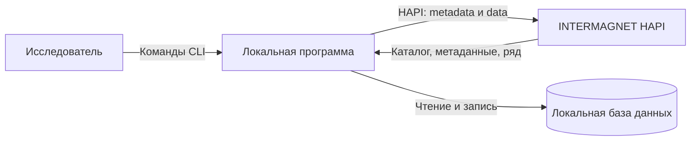
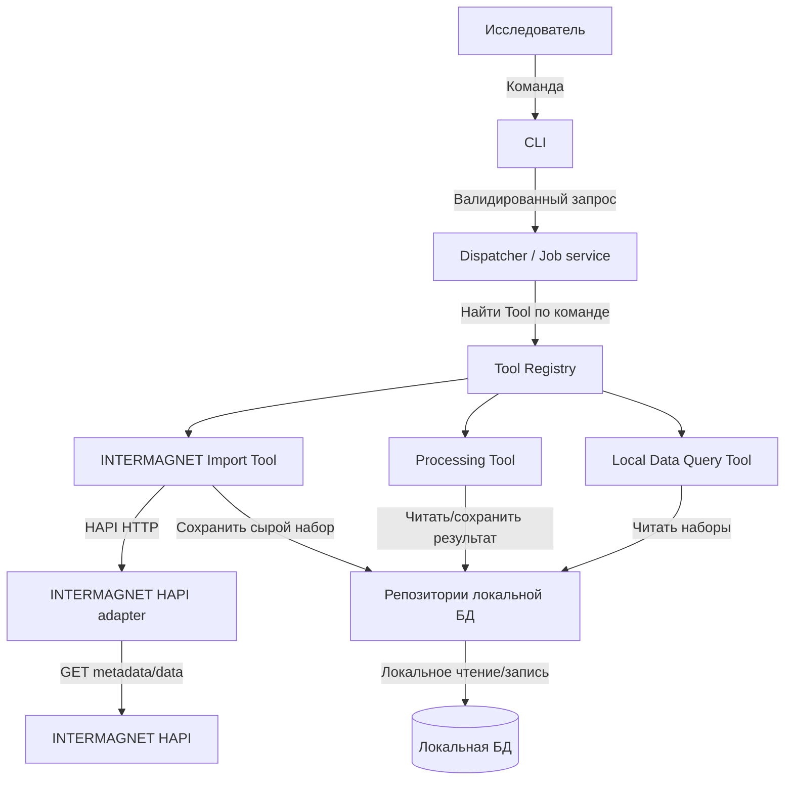
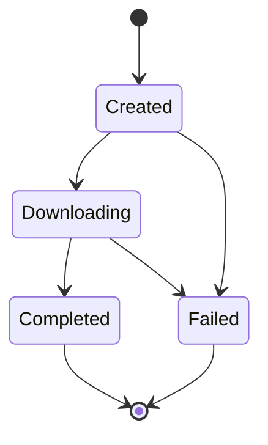
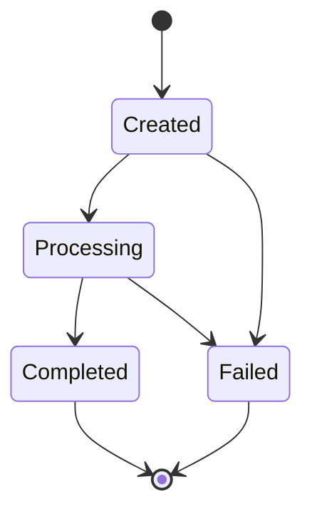

# Архитектура локальной программы геомагнитных данных

## Назначение

Программа устанавливается и работает на компьютере исследователя. Пользователь запускает её операции через CLI. Программа получает сырые геомагнитные данные обсерваторий через HAPI-интерфейс INTERMAGNET, сохраняет ответ в локальной базе данных, запускает обработку по отдельному запросу и сохраняет результат отдельно. Исследователь может читать сырые и обработанные данные из этой же локальной базы.

В программе предусмотрены три Tool: получение сырых данных из INTERMAGNET, обработка выбранного сырого набора и чтение локально сохранённых данных. Tool — внутренняя операция программы с описанными входом, результатом и ошибками. CLI передаёт команды программе; его входные данные описаны отдельно в `docs/api/cli.schema.json`. Локальный HTTP-сервер в этой схеме не используется.

Import Tool использует HAPI-интерфейс INTERMAGNET по адресу `https://imag-data.bgs.ac.uk/GIN_V1/hapi`; нужные операции, параметры и ошибки описаны в его контракте. Формат локального хранения сырого ответа, движок локальной базы и перечень методов обработки должны быть подтверждены командой; они не выводятся из формата HAPI автоматически.

## Контекст

| Взаимодействие | Содержание |
|---|---|
| Исследователь ↔ программа | Запустить команды CLI для импорта, обработки или чтения; получить состояние задания, данные либо ошибку |
| Программа ↔ INTERMAGNET HAPI | Найти набор по каталогу, запросить метаданные и получить временной ряд за период |
| Программа ↔ локальная БД | Сохранить ответ источника, результат обработки и задания; прочитать наборы по запросу |

Внешний доступ нужен только Tool импорта. Обработка и чтение выполняются по данным локальной базы и не обращаются в INTERMAGNET.

## Компоненты

| Компонент | Ответственность и что скрывает от соседей |
|---|---|
| CLI | Разбирает команду и форматирует вывод; скрывает синтаксис командной строки от Dispatcher |
| Dispatcher / Job service | Проверяет запрос, создаёт Job, управляет разрешёнными переходами и вызывает найденный Tool; скрывает жизненный цикл Job от Tool и CLI |
| Tool Registry | Связывает имя операции с Tool; скрывает способ регистрации/поиска обработчика от Dispatcher |
| INTERMAGNET Import Tool | Запрашивает сырой набор и сохраняет его; скрывает правила импорта от Dispatcher |
| Processing Tool | Обрабатывает локальный сырой набор и создаёт отдельный результат; скрывает алгоритм от Dispatcher и Query Tool |
| Local Data Query Tool | Читает сохранённые сырые и обработанные наборы; скрывает детали запросов от CLI |
| INTERMAGNET HAPI adapter | Выполняет HAPI-запросы и разбирает transport/status; скрывает HTTP и HAPI формат от Import Tool |
| Репозитории локальной БД | Читают и сохраняют Job и наборы; скрывают движок и схему БД от Tool |

Только INTERMAGNET HAPI adapter выполняет сетевой запрос. Tool вызываются внутри одного процесса; отдельного локального HTTP API нет.

## Основные сценарии

### 1. Получить сырые измерения

1. Исследователь задаёт через CLI обсерваторию, тип данных, cadence, компоненты и временной интервал.
2. Программа находит подходящий dataset ID через HAPI catalog, проверяет запрос и создаёт Job импорта.
3. `INTERMAGNET Import Tool` получает метаданные через HAPI `info`, затем запрашивает временной ряд через HAPI `data`.
4. Программа сохраняет исходные данные и метаданные происхождения в локальной БД. Данные не заменяются результатом обработки.
5. Job становится `Completed`; исследователь получает идентификатор сохранённого сырого набора.

Если источник недоступен или ответ нельзя безопасно сохранить, Job становится `Failed`, а частичный набор не публикуется как завершённый.

### 2. Обработать сырой набор

1. Исследователь выбирает сохранённый сырой набор, метод обработки и его параметры.
2. Программа проверяет наличие набора и допустимость запроса, затем создаёт отдельный Job обработки.
3. `Processing Tool` читает сырой набор из локальной БД и вычисляет результат.
4. Программа сохраняет обработанный набор отдельно, с ссылкой на исходный набор и параметрами метода.
5. Job становится `Completed`; исходные данные остаются доступными без изменений.

### 3. Прочитать данные

1. Исследователь задаёт тип набора (сырой или обработанный), идентификатор и, при необходимости, фильтры.
2. `Local Data Query Tool` читает только локальную БД.
3. Программа возвращает данные и их метаданные. При отсутствии набора возвращает `dataset_not_found`.

## Хранение и происхождение

- Сырой ответ и обработанный результат являются разными наборами с разными идентификаторами.
- «Сырой» означает, что набор ещё не прошёл обработку нашим Processing Tool. INTERMAGNET различает publication states; выбранное состояние сохраняется в происхождении и не подменяется общим словом «исходный».
- Для набора сохраняются dataset ID INTERMAGNET, параметры запроса, время получения, HAPI metadata и исходное содержимое ответа. Точная схема содержимого зависит от выбранного формата HAPI.
- Для результата обработки сохраняются идентификатор исходного набора, идентификатор метода, параметры, время выполнения и содержимое результата.
- Результат обработки не перезаписывает и не удаляет исходный набор.
- Совместимые требования P1 к сохранению времени, компоненты, единицы и происхождения применяются к тем полям, которые присутствуют и подтверждены источником. Неизвестные значения не угадываются.

## Job и переходы

Каждый импорт и каждый запуск обработки создаёт отдельный Job. Чтение локальной БД — запрос, для которого отдельный Job не требуется.

Импорт:

Обработка:

`Completed` и `Failed` — конечные состояния. Любой неописанный переход запрещён и возвращает `invalid_job_transition`, не меняя Job. Если запуск не начался из-за внутренней ошибки, допустим переход `Created → Failed`. Повторная обработка создаёт новый Job и новый результат.
