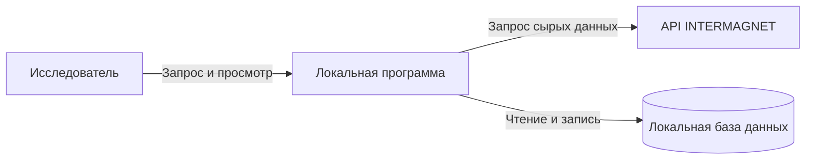
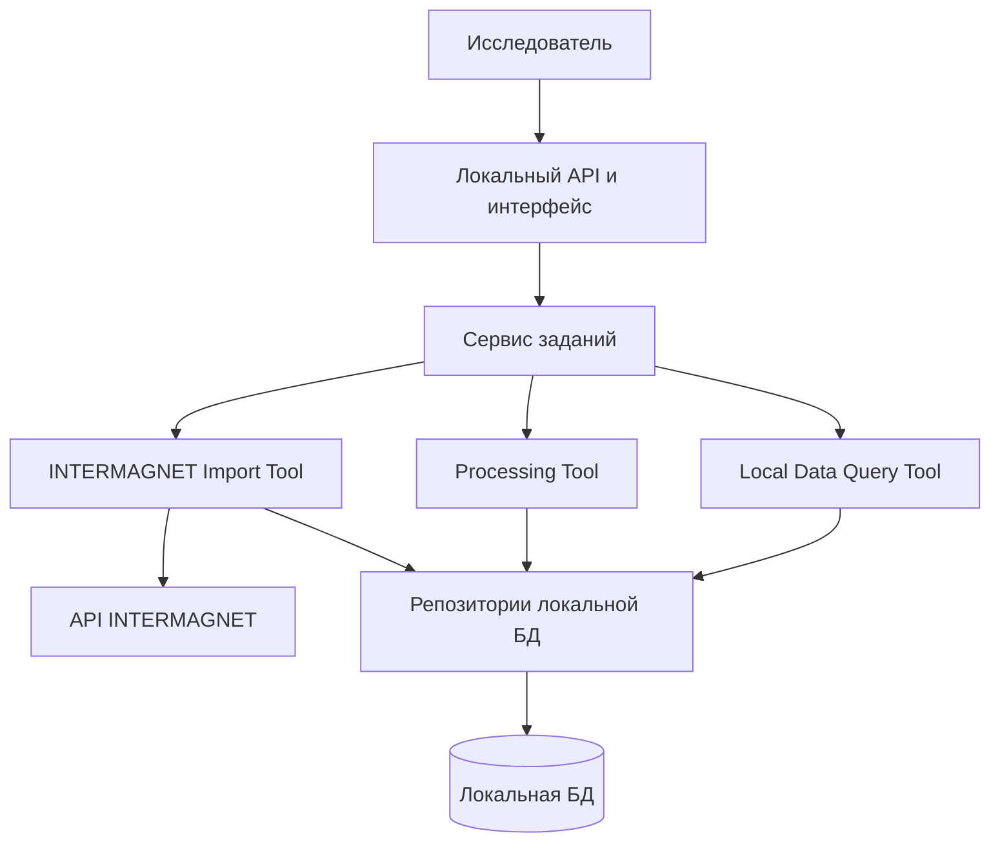
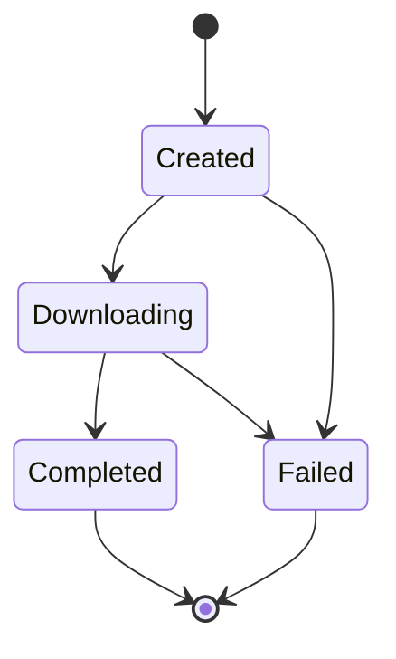
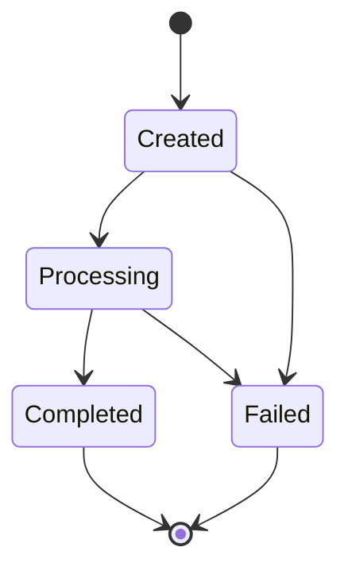

# Архитектура локальной программы геомагнитных данных

## Назначение

Программа устанавливается и работает на компьютере исследователя. Она получает сырые геомагнитные данные обсерваторий через API INTERMAGNET, сохраняет исходный ответ в локальной базе данных, запускает обработку по отдельному запросу и сохраняет результат отдельно. Исследователь может читать сырые и обработанные данные из этой же локальной базы.

В программе предусмотрены три Tool: получение сырых данных из INTERMAGNET, обработка выбранного сырого набора и чтение локально сохранённых данных. Tool — внутренняя операция программы с описанными входом, результатом и ошибками. Интерфейс исследователя обращается к локальному API программы; этот API не является API INTERMAGNET и не предполагает размещение программы в интернете.

Конкретные адреса и схема API INTERMAGNET, формат сырого ответа, движок локальной базы и перечень методов обработки должны быть подтверждены командой. До этого документы не фиксируют неподтверждённые поля внешнего API и алгоритмы.

## Контекст

| Взаимодействие | Содержание |
|---|---|
| Исследователь ↔ программа | Запросить импорт, обработку или чтение; получить состояние задания, данные либо ошибку |
| Программа ↔ INTERMAGNET | Получить сырые измерения для заданных обсерватории и периода |
| Программа ↔ локальная БД | Сохранить ответ источника, результат обработки и задания; прочитать наборы по запросу |

Внешний доступ нужен только Tool импорта. Обработка и чтение выполняются по данным локальной базы и не обращаются в INTERMAGNET.

## Компоненты

Сервис заданий проверяет запрос, создаёт Job и сохраняет его состояние. Он вызывает нужный Tool и фиксирует завершение. Репозитории скрывают детали чтения и записи локальной БД. Только `INTERMAGNET Import Tool` выполняет сетевой запрос.

## Основные сценарии

### 1. Получить сырые измерения

1. Исследователь указывает обсерваторию, временной интервал и необходимые компоненты, поддерживаемые согласованным интерфейсом.
2. Программа проверяет запрос и создаёт Job импорта.
3. `INTERMAGNET Import Tool` получает ответ через API INTERMAGNET.
4. Программа сохраняет исходные данные и метаданные происхождения в локальной БД. Данные не заменяются результатом обработки.
5. Job становится `Completed`; исследователь получает идентификатор сохранённого сырого набора.

Если источник недоступен или ответ нельзя безопасно сохранить, Job становится `Failed`, а частичный набор не публикуется как завершённый.

### 2. Обработать сырой набор

1. Исследователь выбирает сохранённый сырой набор, метод обработки и его параметры.
2. Программа проверяет наличие набора и допустимость запроса, затем создаёт отдельный Job обработки.
3. `Processing Tool` читает сырой набор из локальной БД и вычисляет результат.
4. Программа сохраняет обработанный набор отдельно, с ссылкой на исходный набор и параметрами метода.
5. Job становится `Completed`; исходные данные остаются доступными без изменений.

### 3. Прочитать данные

1. Исследователь задаёт тип набора (сырой или обработанный), идентификатор и, при необходимости, фильтры.
2. `Local Data Query Tool` читает только локальную БД.
3. Программа возвращает данные и их метаданные. При отсутствии набора возвращает `dataset_not_found`.

## Хранение и происхождение

- Сырой ответ и обработанный результат являются разными наборами с разными идентификаторами.
- Для сырого набора сохраняются доступные идентификаторы источника/обсерватории, параметры запроса, время получения и исходное содержимое ответа. Точная схема содержимого зависит от подтверждённого контракта INTERMAGNET.
- Для результата обработки сохраняются идентификатор исходного набора, идентификатор метода, параметры, время выполнения и содержимое результата.
- Результат обработки не перезаписывает и не удаляет исходный набор.
- Совместимые требования P1 к сохранению времени, компоненты, единицы и происхождения применяются к тем полям, которые присутствуют и подтверждены источником. Неизвестные значения не угадываются.

## Job и переходы

Каждый импорт и каждый запуск обработки создаёт отдельный Job. Чтение локальной БД — запрос, для которого отдельный Job не требуется.

Импорт:

Обработка:

`Completed` и `Failed` — конечные состояния. Любой неописанный переход запрещён и возвращает `invalid_job_transition`, не меняя Job. Если запуск не начался из-за внутренней ошибки, допустим переход `Created → Failed`. Повторная обработка создаёт новый Job и новый результат.

## Границы и нерешённые решения

Документы описывают систему, а не подтверждают уже реализованные функции. До реализации необходимо согласовать точный интерфейс INTERMAGNET и допустимые запросы, формат сохранения сырого ответа, используемую локальную БД, методы обработки и форму локального API. Программа не является удалённым сервисом и не хранит пользовательские наборы во внешней базе.
